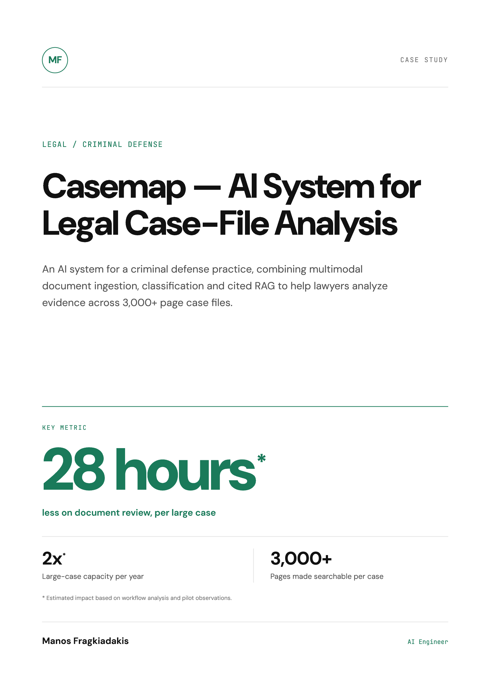
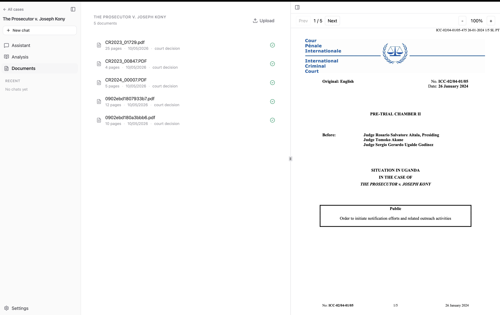
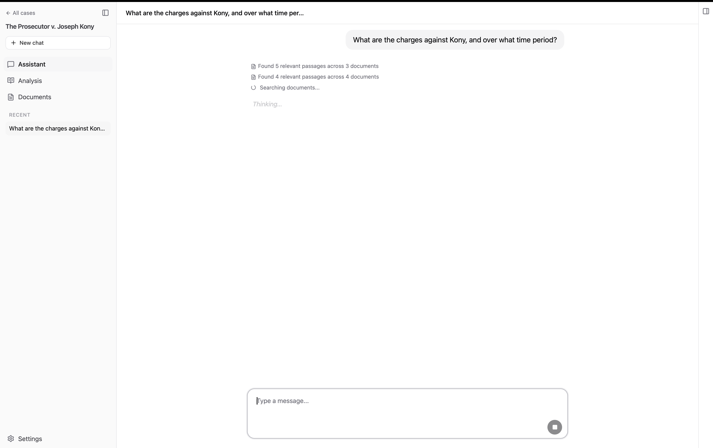
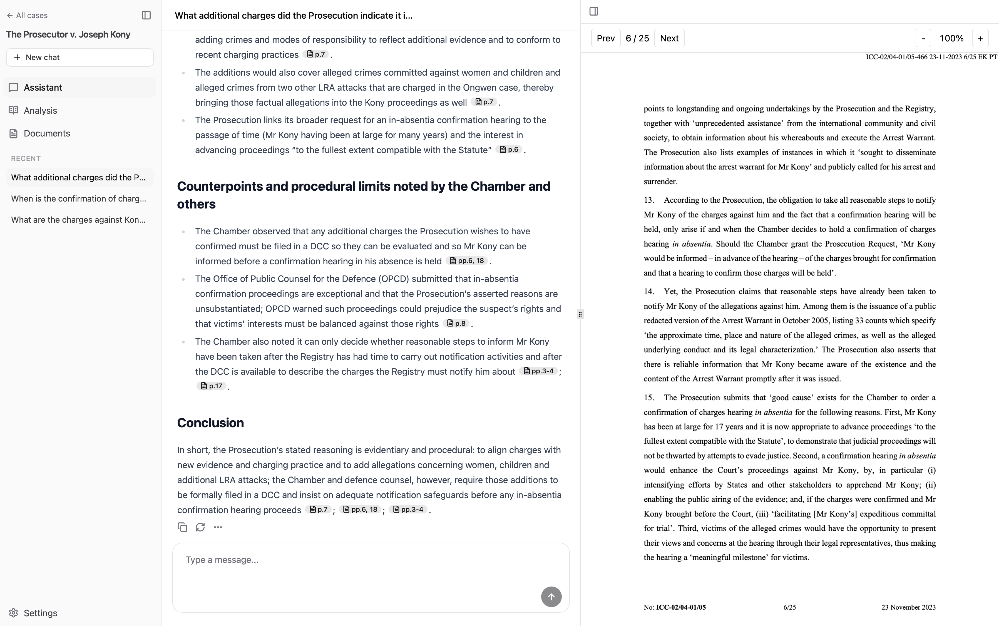

# Casemap — AI System for Legal Case-File Analysis

**A document-intelligence system for a criminal defense practice, combining multimodal ingestion, classification, advanced RAG, and cited answers across 3,000+ page case files.**

## At a glance

| Result | What it means |
| --- | --- |
| **28 hours saved\*** | Estimated reduction in document-review time per large case |
| **47%\*** | Estimated reduction in review time |
| **3,000+ pages** | Documents made searchable per case |
| **2× capacity\*** | Estimated annual large-case capacity at the practice's current case volume |

\* Estimated impact based on workflow analysis and pilot observations.

## The situation

A four-person criminal defense practice spent more than 60 hours analyzing every large case file: reading thousands of pages and tracking how names, dates, and evidence connected across them.

Notes lived in post-its and Word documents scattered across the team, and cross-referencing 3,000-page files with Ctrl+F was no longer working. General-purpose AI tools could not cross-reference thousands of pages of witness statements, court decisions, and scanned reports with the source citations the lawyers needed to verify the evidence.

## What I built

I built Casemap — case-analysis software shaped around the way the team reviews large criminal case files. It ingests PDFs, scanned documents, handwritten notes, and photographs, using computer vision and multimodal AI where needed. It classifies documents by type, indexes the complete file, and maps parties, roles, relationships, dates, events, and communications, including through named-entity recognition.

*All case documents in one place — classified, indexed and searchable from the start.*

Lawyers can ask questions across the case file using advanced RAG and multi-agent retrieval. Answers include citations that open the original PDF in a side panel, allowing the lawyer to inspect the evidence behind each answer.

*Ask questions across the full case file.*

*Every answer is cited. Click a citation to open the original PDF in the side panel.*

After reviewing the evidence, the associate can use highlights and annotations to produce a structured working case summary. Legal judgment stays with the lawyers.

## How it works

| Step | What happens |
| --- | --- |
| **Ingest** | PDFs, scans, handwritten notes, and photographs are processed using OCR and multimodal AI where needed. |
| **Organize** | Documents are classified and indexed; people, roles, relationships, dates, and events are mapped across the case file. |
| **Retrieve** | Advanced RAG and multi-agent retrieval search the file for evidence relevant to a question. |
| **Verify** | Answers cite supporting documents, which can be opened in the PDF side panel. |
| **Review** | The associate checks the evidence and prepares a working case summary from highlights and annotations. |

**Core capabilities:** Multimodal ingestion · OCR · Advanced RAG · Multi-agent retrieval · Citation grounding

**Tech stack:** FastAPI · LangGraph · Next.js · PostgreSQL · Microsoft Foundry / Azure

## Results

- **28 hours saved per large case**, an estimated **47% reduction** in document-review time.
- **3,000+ pages made searchable per case**, including scanned and unstructured documents.
- **2× estimated large-case capacity per year** at the practice's current case volume, without adding headcount or reducing human review.

Long manual passes through the case file became a guided review with cited answers and source verification.

*Estimated impact based on workflow analysis and pilot observations.*

## Full case study

The designed case study is available as a PDF: [Casemap — AI System for Legal Case-File Analysis](ai-legal-case-file-analysis.pdf).

## About Manos

Manos Fragkiadakis is an Applied AI Engineer building document intelligence and AI knowledge systems. He has over five years of Python software development experience and has built custom ERP and CRM systems for professionals. His recent work includes cited RAG across 3,000+ page legal case files and court-monitoring automation software used by 10+ law offices. He previously worked as an AI engineer and taught Natural Language Processing at Utrecht University.

[GitHub](https://github.com/emfrg)
